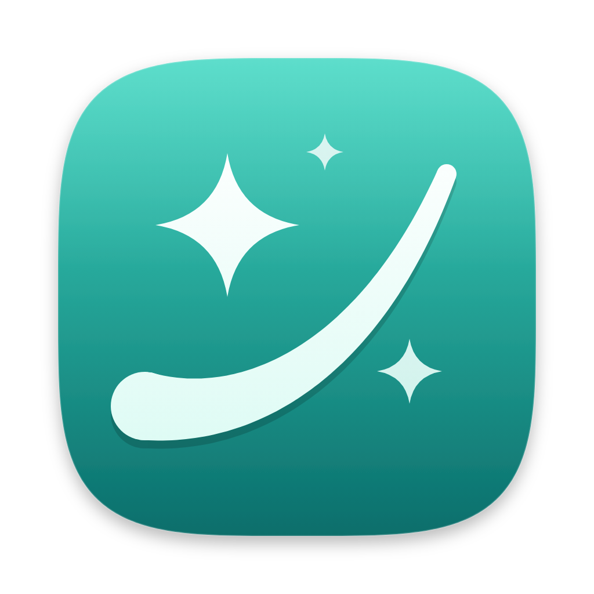

<p align="center">
  
</p>

# TidyMyMac

A native Mac cleaner for Apple Silicon Macs on macOS 14 or newer. It finds caches, logs, leftovers from removed apps, large and duplicate files and other clutter, shows you exactly what it found, and removes only what you confirm. Most things go to the Trash, so you can change your mind, and every run is logged.

It is written in Swift 6 and SwiftUI with no third-party Swift packages, and it is free and open source under the [MIT licence](LICENSE).

**Status:** v1 is being built milestone by milestone (see [the build order](docs/spec/README.md#7-build-order)). There is no signed download yet, so build it from source.

## What it is not

- **Not affiliated with MacPaw or CleanMyMac.** TidyMyMac is an independent project with its own name, look and code. It was built clean-room: no MacPaw binaries, rules or assets were downloaded, decompiled or inspected.
- **Not a "speed up your Mac" tool.** It does not free RAM, repair permissions, strip languages from apps, shred files, run periodic scripts or play purgeable-space tricks. Those features are harmful or obsolete on modern macOS, so they are left out on purpose.
- **Not automatic.** Nothing is ever removed unattended, and there is no scheduled cleaning.

## Features

| Module | What it does |
|---|---|
| **Tidy Up** | One scan across everything, a few result cards, one review sheet, one confirm. |
| **Health** | Overall status, storage (purgeable space shown read only), Trash size, setup status, run history with restore, and optional reminders. |
| **Cleanup** | User and system caches and logs, Xcode junk, AI app junk, local AI models and iOS backups (both marked risky), Trash bins, broken login items, and an ignore list. |
| **Declutter** | Large and old files, duplicates (aware of APFS clones), a Downloads review, and duplicate downloads. |
| **Disk Map** | A treemap and size-ranked list of any folder or volume. |
| **Applications** | An uninstaller that finds related files, unused apps, leftovers from apps you already removed, installer leftovers, and an update check for Sparkle, Electron, Homebrew and macOS (it checks, it never installs). |
| **Performance** | Flush DNS, reindex Spotlight, thin Time Machine local snapshots, login items and background items. |
| **Protection** | Each privacy area (Camera, Microphone, Full Disk Access and so on) explained, with a button to its System Settings pane. |
| **My Tools** | A launcher grid that jumps straight to any tool. |
| **Menu bar** | CPU, memory, storage and network at a glance, with low-disk and full-Trash alerts. |

The full v1 scope is in the [build spec](docs/spec/README.md#3-scope-v1-features), and the window layout is in [spec 007](docs/spec/007-app-layout.md).

## Screenshots

Screenshots are coming. They will be taken against a test home folder filled with sample files, never a real person's data.

## Safety model

A cleaner is only useful if you can trust it. These rules are enforced in code and tests, not only in the UI.

- **Protected floor.** A list of places nothing may remove lives in code, in the `SafetyFloor` library, and both the app and the admin helper check it. It covers system folders, your home and `/Applications` themselves, your personal folders as a whole, iCloud and cloud storage folders, keychains, Mail, the Photos and Music libraries, and anything inside an app bundle or package. No rule, setting or hand pick can get past it. See [spec 006 §5](docs/spec/006-safety-rules.md#5-checks-built-into-the-engine).
- **Trash by default.** Only caches and logs are deleted permanently. Everything else goes to the Trash, and items TidyMyMac trashed can be put back from the run history.
- **Review before every removal.** Each cleanup ends in one confirmation that names how many items, how much space, and where they go (the Trash, or deleted).
- **Dry run first.** Every rule and every helper operation can run report-only. New rules ship as `experimental`, unticked, until they have been dry-run on a real Mac.
- **Every run is logged.** One JSON Lines file per run, dry runs included, in `~/Library/Application Support/TidyMyMac/RunLog/`. **Settings › General › Reveal Run Logs** opens the folder.
- **The helper decides what it may touch.** System-level work runs in a small root helper. The app never sends it a path, only handles the helper issued after its own checks. See [spec 005](docs/spec/005-admin-helper.md).
- **Bundled rules only.** Cleaning rules are JSON files in [`Rules/`](Rules/) shipped inside the app and linted by `scripts/lint-rules.sh`. They are never downloaded.

## Requirements

- A Mac with Apple Silicon (arm64 only).
- macOS 14 Sonoma or newer.
- The app at `/Applications/TidyMyMac.app`. The admin helper only works from there; anywhere else, system-level features ask you to move the app.
- Full Disk Access is recommended. Without it, the features that need it (Trash bins, iOS backups, app containers) show greyed out with a button to grant access. They are never half-run.

## Building from source

You need Xcode with Swift 6, [Homebrew](https://brew.sh), and an Apple ID signed in to Xcode. A free Personal Team is enough.

```bash
brew install xcodegen
git clone https://github.com/joswalt/tidy-my-mac.git
cd tidy-my-mac
xcodegen generate
open TidyMyMac.xcodeproj
```

`TidyMyMac.xcodeproj` is generated from [`project.yml`](project.yml) and is not checked in. Change targets and build settings in `project.yml`, then run `xcodegen generate` again.

### Signing

The app and helper are signed with an "Apple Development" certificate, with the hardened runtime on and no App Sandbox.

- **Use your own team.** Put your team ID in `DEVELOPMENT_TEAM` in [`Config/Identity.xcconfig`](Config/Identity.xcconfig). `scripts/check-local.sh` also checks for the maintainer's team ID, so change it there too.
- **Never sign ad hoc** ("Sign to Run Locally"). launchd refuses to start an ad hoc signed helper.
- **WWDR G3 certificate.** If `codesign` fails with `errSecInternalComponent`, your keychain is missing Apple's intermediate certificate. Download `AppleWWDRCAG3.cer` from [Apple's certificate authority page](https://www.apple.com/certificateauthority/) and import it into your login keychain.
- `security find-identity -v -p codesigning` should list your "Apple Development" identity.

After building, copy `TidyMyMac.app` to `/Applications` and open it from there. The first time you use a system-level feature, macOS asks you to allow the helper in **System Settings › General › Login Items**.

### Tests and checks

Run the library tests:

```bash
swift test --package-path Packages/TidyCore
```

Lint the rules and check that code reaches user folders only through the injected `Home` value:

```bash
scripts/lint-rules.sh && scripts/safety-lint.sh
```

Run everything, plus a signed Release build and code signature checks:

```bash
scripts/check-local.sh
```

Tests never touch your real home folder: they build a fake one (`TestHome`) in a temporary directory. CI runs the tests, the lints and an unsigned build on every pull request.

## Project layout

```
App/                SwiftUI app: window, menu bar, Settings (UI only, no file system access)
Helper/             The root helper's entry point (XPC wiring only)
Packages/TidyCore/  Swift package with nine libraries:
  SafetyFloor         the protected floor, shared by app and helper
  HelperProtocol      the XPC interface between app and helper
  HelperCore          the helper's logic: zones, handles, ledger, operations
  RuleEngine          loads, lints, matches and sizes rules; dry runs
  AppInventory        installed apps, leftovers, update checks
  DiskAnalysis        large files, duplicates, Disk Map
  SystemTasks         maintenance tasks, login and background items
  Monitors            menu bar monitors, alerts, Health signals
  RunLog              the per-run log and restore
Rules/              Bundled JSON cleaning rules and their credits
Config/             xcconfig files: signing team and bundle IDs
design/             App icon, style guide and layout prototype
docs/spec/          The v1 build spec (start at docs/spec/README.md)
docs/planning/      Planning history and research (background, not instructions)
scripts/            Lints and local checks
ThirdPartyLicenses/ Licence texts for reused code
project.yml         XcodeGen project definition
```

Libraries never import SwiftUI, and the UI never touches the file system. Details are in [spec 016](docs/spec/016-repo-layout.md).

## Contributing

Changes land through pull requests on `main`. Read [docs/spec/README.md](docs/spec/README.md) first. Changes to cleaning rules always need the maintainer's approval, and new rules start as `experimental`. Please don't contribute anything taken from CleanMyMac or other closed-source cleaners.

## Licence and credits

TidyMyMac is released under the [MIT licence](LICENSE).

All current cleaning rules are TidyMyMac's own, written from Apple's documentation of the Library folder layout and from observation. Code and ideas reused from other projects are credited in [`Rules/CREDITS.md`](Rules/CREDITS.md), with full licence texts in [`ThirdPartyLicenses/`](ThirdPartyLicenses/):

- [Sparkle](https://github.com/sparkle-project/Sparkle) (MIT): the version comparison algorithm, ported to Swift with its tests, and the appcast format used by the update check.
- [Homebrew](https://github.com/Homebrew/brew) (BSD-2-Clause): the approach of its livecheck strategies for Sparkle and Electron apps. The code is our own.

The open-source cleaners ClearDisk, mac-cleanup-py, app-cleaner.sh and PureMac may be reused with credit. Mole, Pearcleaner, BleachBit and Latest were studied for ideas only, and no code was copied from them.

CleanMyMac is a trademark of MacPaw. TidyMyMac is not affiliated with or endorsed by MacPaw.
